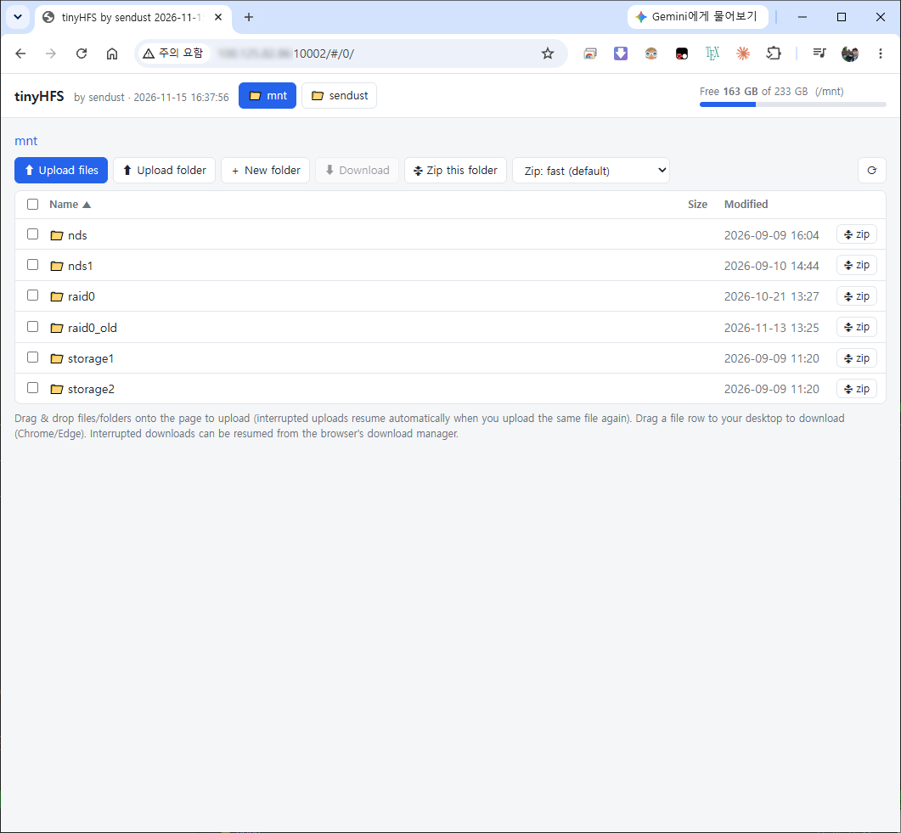

# tinyHFS by sendust

[English](README.md) | **한국어**

작은 HTTP 파일 서버입니다. Windows와 Linux에서 단일 실행파일로 동작하며 외부 의존성이 없습니다 (Go 표준 라이브러리만 사용).



## 사용법

```
tinyhfs[.exe] [root_path1 root_path2 "path N" ...] [port]
```

- 기본 root: 실행파일이 있는 폴더. 기본 포트: `10002`
- 여러 root 경로를 동시에 공유할 수 있고, 페이지 상단 버튼으로 전환합니다.
- 포트 바인딩에 실패하면 포트를 1씩 올려 다시 시도합니다.
- link up 상태이고 IPv4 주소가 있는 모든 NIC에서 서비스하며, 접속 주소를 stdout에 출력합니다.
- 로그는 `./log/tinyhfs_YYYYMMDD.log`에 일별로 기록됩니다.

예시:

```
tinyhfs                          # 실행파일 폴더를 10002 포트로 공유
tinyhfs /mnt /home/sendust 8080  # 두 폴더를 8080 포트로 공유
tinyhfs.exe D:\share "E:\My Files"
```

## 기능 (웹 UI)

- root 이하 폴더 탐색, 현재 root의 여유 공간을 상단에 표시
- 버튼(파일 / 폴더 통째로) 또는 드래그 드롭(파일, 폴더)으로 업로드
- **이어서 올리기**: 8MB 단위로 나눠 전송합니다. 끊긴 업로드는 `이름.tinyhfs-part`로 남고, 같은 파일을 다시 올리거나 ▶ 버튼을 누르면 끊긴 위치부터 이어갑니다.
- 클릭, 버튼, 또는 목록의 행을 바탕화면으로 끌어서 다운로드 (Chrome, Edge)
- **이어서 받기**: HTTP Range / If-Range를 지원하므로 브라우저 다운로드 관리자의 "재개" 버튼, `curl -C - -O URL`, `wget -c URL`로 이어받을 수 있습니다.
- 폴더 zip 압축 다운로드 (선택 항목 또는 현재 폴더). 압축 수준: store / **fast (기본값)** / normal / best
- 폴더 만들기
- 전송 패널: 파일 크기, %, 전송 속도, 남은 시간, 취소 / 재개

## 빌드

Go 1.21 이상이 필요합니다 (https://go.dev/dl/).

```
./build.sh        # Linux/macOS → dist/tinyhfs, dist/tinyhfs.exe, dist/tinyhfs-arm64
build.bat         # Windows     → dist\tinyhfs.exe, dist\tinyhfs
```

페이지 제목은 `tinyHFS by sendust <커밋 날짜/시각>`입니다. git 저장소 안에서 빌드하면 마지막 커밋 시각을, 아니면 빌드 시각을 사용합니다.

## HTTP API

| 메서드 | 경로 | 설명 |
|---|---|---|
| GET | `/api/roots` | root 목록과 여유/전체 용량 |
| GET | `/api/list?root=&path=` | 폴더 내용 |
| POST | `/api/mkdir?root=&path=&name=` | 폴더 만들기 |
| GET | `/api/upload/status?root=&path=&name=&size=` | 중단된 업로드의 이어 올릴 위치 |
| PUT | `/api/upload?root=&path=&name=&size=&offset=[&mtime=]` | 업로드 조각 하나 전송 (요청 본문) |
| GET | `/dl/<root>/<path>` | 다운로드 (Range 지원) |
| GET | `/zip/<root>/<path>[?level=0-9&n=이름...]` | zip 다운로드 |
| GET | `/api/progress?ids=` | 다운로드 진행 상태 |
| POST | `/api/cancel?tid=` | 다운로드 취소 |

## 참고

- **인증 기능이 없습니다.** 포트에 접근할 수 있으면 누구나 탐색, 다운로드, 업로드할 수 있으니 신뢰할 수 있는 네트워크에서만 사용하세요.
- 끌어서 다운로드는 Chromium 계열 브라우저(Chrome, Edge)에서만 됩니다.
- zip은 요청할 때마다 새로 만들기 때문에 이어받기가 되지 않습니다.
