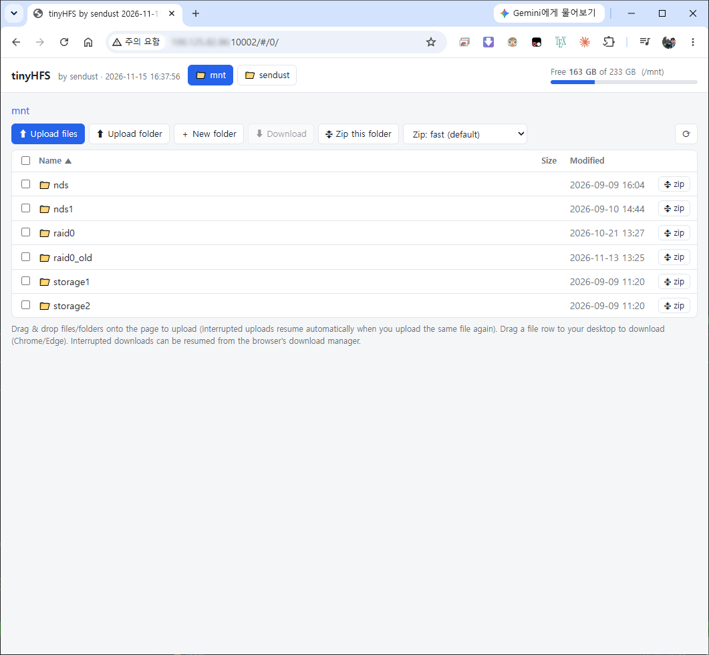

# tinyHFS by sendust

**English** | [한국어](README.ko.md)

Tiny HTTP file server — a single executable for Windows and Linux with no dependencies (Go standard library only).



## Download

Prebuilt binaries: **[Latest release](https://github.com/sendust/tinyHFS/releases/latest)**

| Platform | File |
|---|---|
| Windows x64 | [tinyhfs-windows-amd64.exe](https://github.com/sendust/tinyHFS/releases/latest/download/tinyhfs-windows-amd64.exe) |
| Linux x64 | [tinyhfs-linux-amd64](https://github.com/sendust/tinyHFS/releases/latest/download/tinyhfs-linux-amd64) |
| Linux ARM64 | [tinyhfs-linux-arm64](https://github.com/sendust/tinyHFS/releases/latest/download/tinyhfs-linux-arm64) |
| Checksums | [SHA256SUMS.txt](https://github.com/sendust/tinyHFS/releases/latest/download/SHA256SUMS.txt) |

On Linux:

```
wget https://github.com/sendust/tinyHFS/releases/latest/download/tinyhfs-linux-amd64
chmod +x tinyhfs-linux-amd64
./tinyhfs-linux-amd64
```

## Usage

```
tinyhfs[.exe] [-auth password] [root_path1 root_path2 "path N" ...] [port]
tinyhfs[.exe] -update
```

- `-auth password`: require a password (see [Authentication](#authentication)). Without it anyone on the network can access.
- Default root: the executable's folder. Default port: `10002`.
- Several root paths can be shared at once; switch between them with the buttons at the top of the page.
- If the port is busy, port+1, +2 … is tried.
- Serves on every NIC that is up and has an IPv4 address; the access URLs are printed to stdout.
- Logs are written to `./log/tinyhfs_YYYYMMDD.log`.
- `-update`: downloads the latest GitHub release for this OS, verifies it against `SHA256SUMS.txt` and replaces the executable, then exits (restart the server afterwards). On Windows the old file is kept as `tinyhfs.exe.old` until the next start. Needs write permission on the executable's folder and HTTPS access to github.com. Available from the release after v1.6.0 (older builds must be replaced by hand once).

Examples:

```
tinyhfs                          # share the executable's folder on port 10002
tinyhfs /mnt /home/sendust 8080  # share two folders on port 8080
tinyhfs.exe D:\share "E:\My Files"
tinyhfs -auth MyPass123 /mnt     # password protected
```

## Features (web UI)

- Folder browsing under each root; free space of the current root shown at the top
- Upload with buttons (files / whole folder) or drag & drop (files and folders)
- **Resumable upload**: files are sent in 8 MB chunks. A broken upload leaves `name.tinyhfs-part`; upload the same file again (or press ▶) and it continues where it stopped
- Download by click, button, or dragging a row to the desktop (Chrome, Edge)
- **Resumable download**: HTTP Range / If-Range supported → resume from the browser's download manager, or with `curl -C - -O URL` / `wget -c URL`
- Folder zip download (selection or whole folder); compression: store / **fast (default)** / normal / best
- Create folders
- **File search**: searches the current folder and all subfolders by name. Case-insensitive; space separated words must all match (`report 2026`); wildcards `*` `?` match the whole name (`*.mp4`). Up to 1000 results / 2 min per search; folders are read in parallel and progress (items/folders scanned, results so far, current folder) is shown live with a Stop button. Results can be downloaded, zipped (folder structure kept) or opened
- **Image / media preview**: clicking an image (jpg, png, gif, webp, bmp, svg, avif, ico), video (mp4, webm, mov, mkv, ogv), audio (mp3, m4a, aac, wav, flac, ogg, opus), text/code (txt, log, md, csv, json, xml, yaml, srt, source code… first 2 MB, UTF-8/UTF-16/EUC-KR detected), Markdown (rendered: headings, lists, tables, code, links, relative images; or as source), HTML (rendered in a sandbox without scripts, or as source) or PDF opens it in a right-side pane (images scaled to fit, video/audio with a player and seeking) instead of downloading. Playback depends on the browser's codecs (e.g. MXF, AVI, WMV are not playable). ◀ ▶ / arrow keys browse previewable files in the folder, Esc closes, drag the pane edge to resize
- **Live folder updates**: the open folder refreshes by itself when files are added, removed or changed (also by other users, WebDAV or the host). The server polls only folders that a browser currently has open (every 2 s, less often for big/slow folders, so it also works on SMB/NFS mounts) and pushes changes with Server-Sent Events; with no client watching, nothing is polled. Background tabs stop watching and refresh when shown again
- **Copy between servers (drag & drop)**: with two tinyHFS servers open in two browser tabs/windows, drag files or folders (or a selection) from one page and drop them on the other: the receiving server downloads them directly from the sending server (the data does not pass through the browser), with progress, cancel, original modification times, and overwrite/skip for existing names. Folders are copied recursively. The servers must reach each other over the network. If the source runs with `-auth`, the drag carries a read-only token for that folder (valid 12 h, sent as a header, not logged). The receiving server only requests `/api/list` and `/dl/` from the dropped address and does not follow redirects. **If the servers are on different networks**: the receiving server also tries the sending server's other IPv4 addresses; if none is reachable, the page falls back to copying *through the browser* (reads from the sending server, uploads to the receiving one with the resumable upload — slower, and the tab must stay open; empty folders are not created). For that the sending server answers cross-origin requests on `/api/list` and `/dl/` only when they carry a valid token
- **Open in a player (mpv, VLC)**: drag a file row onto the player window; it gets the file URL (`/dl/...`, seekable). With `-auth` the URL carries a link token (`?xt=...`) valid only for that one file, read-only, for about 6 hours (until the server restarts at the latest), masked in the log.
- **Password authentication** (`-auth`)
- **WebDAV server** at `/webdav/` — connect as a network drive (see [WebDAV](#webdav))
- Transfer panel: size, %, speed, remaining time, cancel / resume

## Authentication

```
tinyhfs -auth MyPass123 /mnt
```

- Browsers get a login page; after login a session cookie is kept for 7 days (until the server restarts). A **Logout** button appears at the top right.
- Command line tools use HTTP Basic auth with any user name:
  ```
  curl -u :MyPass123 -C - -O http://host:10002/dl/0/path/file
  wget --user=x --password=MyPass123 -c http://host:10002/dl/0/path/file
  ```
- 5 wrong passwords from one IP → that IP is blocked for 5 minutes. Login results are written to the log.
- **Delete** (files and folders, folders recursively) is available only when `-auth` is on: select items and press **🗑 Delete** or the Delete key. Every deletion is logged with the client IP. Without `-auth` the web UI has no delete button and WebDAV `DELETE` is refused (403).
- The password on the command line is visible to other users of the host (`ps`). To avoid that, set the environment variable `TINYHFS_AUTH` instead of `-auth`.
- Traffic is plain HTTP (not encrypted). Use it on trusted networks or behind a VPN / HTTPS reverse proxy.

## WebDAV

Every shared folder is also served over WebDAV:

```
http://<address>:10002/webdav/            top folder (read-only), one sub folder per root
http://<address>:10002/webdav/<root name>/ files of that root (read/write)
```

Opening `/webdav/` in a web browser shows a **connection guide** (English / 한국어) with the real server address filled in:
how to map a network drive on Windows, macOS and Linux, and the limits of the built-in Windows WebDAV client with workarounds.
The 🔗 WebDAV button in the web UI opens the same page.

Windows quick start:

```
net use Z: http://<address>:10002/webdav/ /persistent:yes
```

Built-in Windows client limits (details and a fix script on the guide page):

| Limit | Workaround |
|---|---|
| `WebClient` service must run | `sc config WebClient start= auto` + `net start WebClient` |
| Password over plain HTTP refused (with `-auth`) | registry `BasicAuthLevel = 2` |
| Files > 50 MB fail | registry `FileSizeLimitInBytes = 0xFFFFFFFF` (max 4 GB; larger files: use the web UI or RaiDrive / WinSCP / rclone) |
| Big folders fail to list | registry `FileAttributesLimitInBytes = 50000000` |
| Slow | Internet Options → LAN settings → uncheck "Automatically detect settings" |

With `-auth`, WebDAV clients log in with any user name and the server password.
Moving files between different roots is not supported, and the roots themselves cannot be deleted or renamed.

## Build

Requires Go ≥ 1.26 (https://go.dev/dl/). Dependency: `golang.org/x/net/webdav` (fetched automatically by `go build`).

```
./build.sh        # Linux/macOS → dist/tinyhfs, dist/tinyhfs.exe, dist/tinyhfs-arm64
build.bat         # Windows     → dist\tinyhfs.exe, dist\tinyhfs
```

The browser tab title is `tinyHFS [<hostname>]`; the header shows `tinyHFS by sendust [<commit date/time>]`. The date comes from the last git commit when built inside a git repository, otherwise the build time is used.

## HTTP API

| Method | Path | Description |
|---|---|---|
| GET | `/api/roots` | Roots with free/total bytes |
| GET | `/api/list?root=&path=` | Folder listing |
| GET | `/api/search?root=&path=&q=[&limit=][&stream=1]` | Recursive name search (`stream=1`: NDJSON progress + results) |
| POST | `/api/delete` JSON `{"root":0,"path":"/dir","names":["a.txt","sub"]}` | Delete files/folders (only with `-auth`) |
| GET | `/api/watch?root=&path=` | Server-Sent Events: `event: change` when the folder's listing changes |
| POST | `/api/rcopy` JSON `{"src":{"origin":"http://hostA:10002","root":0,"token":"","items":[{"path":"/dir/a.mp4"}]},"dst":{"root":0,"path":"/"},"policy":"overwrite","tid":"x1"}` | Copy from another tinyHFS server into this one (progress via `/api/progress?ids=x1`) |
| POST | `/api/mkdir?root=&path=&name=` | Create folder |
| GET | `/api/upload/status?root=&path=&name=&size=` | Resume offset of a partial upload |
| PUT | `/api/upload?root=&path=&name=&size=&offset=[&mtime=]` | Upload one chunk (request body) |
| GET | `/dl/<root>/<path>` | Download (Range supported) |
| GET | `/zip/<root>/<path>[?level=0-9&n=name...]` | Zip download |
| GET | `/api/progress?ids=` | Download progress |
| POST | `/api/cancel?tid=` | Cancel a download |
| POST | `/api/login` (`{"password":"..."}`) / `/api/logout` | Login / logout (when `-auth` is used) |
| WebDAV | `/webdav/...` | WebDAV class 1/2 (PROPFIND, PUT, MKCOL, COPY, MOVE, DELETE, LOCK …) |

## Notes

- Without `-auth` there is **no authentication**: anyone who can reach the port can browse, download and upload.
- Drag-out download works only in Chromium browsers (Chrome, Edge).
- Zip downloads are generated on the fly, so they cannot be resumed.
